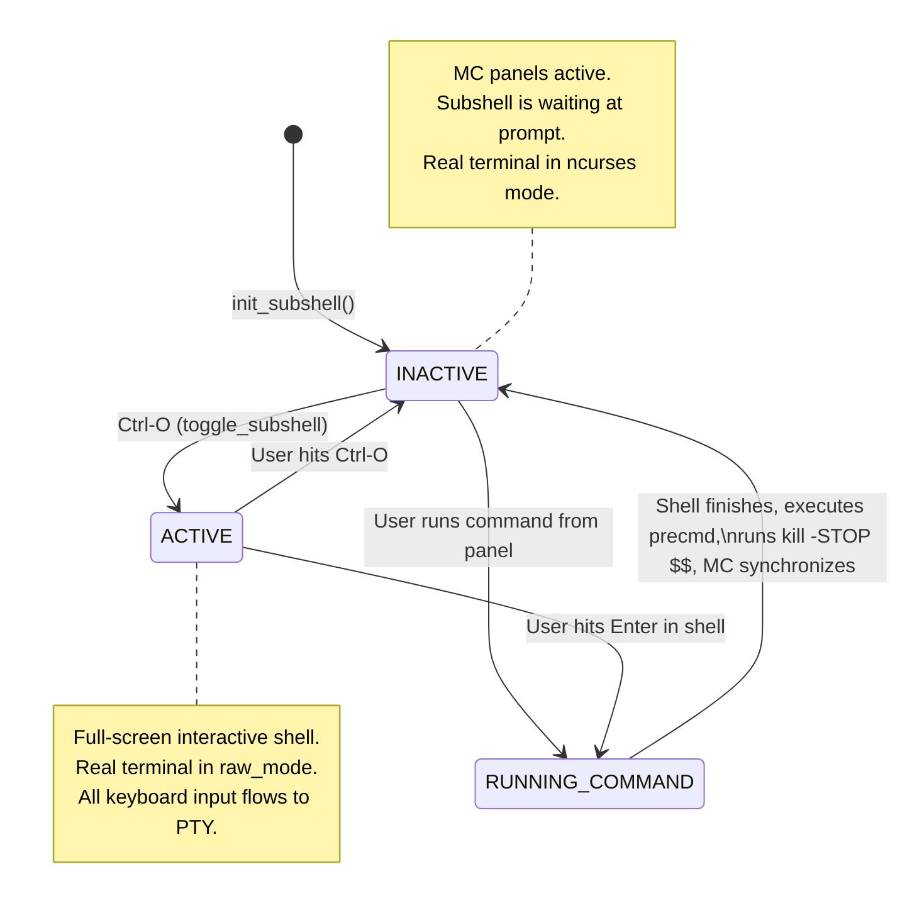

# Deep Dive: Shell Interaction and Subshell Integration in Midnight Commander

Midnight Commander (`mc`) delivers a fluid, interactive terminal file management experience where the user can seamlessly switch between file panels and an interactive command shell. Running commands, switching directories, and toggling between the visual file manager and a live shell prompt feels almost native.

Achieving this seamlessness over standard Unix terminal and process semantics requires sophisticated engineering. This report examines the architecture, IPC mechanisms, terminal manipulation, and edge-case handling across the Midnight Commander codebase based on:
- [`src/subshell/common.c`](file:///home/dbehr/gits/mc/src/subshell/common.c) and [`src/subshell/subshell.h`](file:///home/dbehr/gits/mc/src/subshell/subshell.h)
- [`src/execute.c`](file:///home/dbehr/gits/mc/src/execute.c) and [`src/execute.h`](file:///home/dbehr/gits/mc/src/execute.h)
- [`lib/shell.c`](file:///home/dbehr/gits/mc/lib/shell.c) and [`lib/shell.h`](file:///home/dbehr/gits/mc/lib/shell.h)
- [`src/filemanager/command.c`](file:///home/dbehr/gits/mc/src/filemanager/command.c)
- [`src/filemanager/cd.c`](file:///home/dbehr/gits/mc/src/filemanager/cd.c)
- [`src/cons.handler.c`](file:///home/dbehr/gits/mc/src/cons.handler.c) and [`src/consaver/cons.saver.c`](file:///home/dbehr/gits/mc/src/consaver/cons.saver.c)
- [`contrib/mc-wrapper.sh.in`](file:///home/dbehr/gits/mc/contrib/mc-wrapper.sh.in)

---

## 1. High-Level Architecture: Two Modes of Execution

Midnight Commander operates in one of two modes depending on system support, configuration, and build options (`ENABLE_SUBSHELL`):

```
+-----------------------------------------------------------------------------------+
|                           Midnight Commander (Main Process)                       |
|                                                                                   |
|  Panel GUI / WInput Commandline ("the_cmdline") <----> Terminal Event Loop       |
+------------------------------------------+----------------------------------------+
                                           |
                 +-------------------------+-------------------------+
                 | Subshell Enabled?                                 | Subshell Disabled /
                 | (mc_global.tty.use_subshell == TRUE)              | Fallback Mode
                 v                                                   v
+------------------------------------+             +--------------------------------+
| Concurrent Subshell Architecture   |             | One-Off Process Execution      |
|                                    |             |                                |
| - Persistent shell child process   |             | - my_systemv_flags() / fork()  |
| - Dedicated Master/Slave PTY pair  |             | - Exec "/bin/sh -c <cmd>"      |
| - Dedicated IPC Pipes (CWD, buffer)|             | - Suspends MC until exit       |
| - Precmd / PROMPT_COMMAND hooks    |             | - "Press any key to continue"  |
| - SIGSTOP / SIGCONT synchronization|             | - No persistent environment,   |
| - Seamless C-o terminal toggle     |             |   shell aliases, or variables  |
+------------------------------------+             +--------------------------------+
```

1. **Fallback / Synchronous Execution Mode** (`my_systemv_flags` in [`lib/utilunix.c`](file:///home/dbehr/gits/mc/lib/utilunix.c#L546)):
   - Used when PTY allocation fails, the shell is unsupported, or `--subshell` is disabled.
   - MC suspends its screen, puts the real TTY into standard cooked/shell mode, runs `fork()` and `execvp()` (typically invoking `$SHELL -c <command>`), waits for the child to exit via `waitpid()`, optionally prompts *"Press any key to continue..."*, and repaints panels.
   - **Limitations**: No environment variables or aliases persist between commands, and toggling full-screen shell (`Ctrl-O`) is unavailable or limited.

2. **Concurrent Subshell Mode** ([`src/subshell/common.c`](file:///home/dbehr/gits/mc/src/subshell/common.c)):
   - An asynchronous child shell process is launched once at MC startup and remains alive throughout the entire MC session.
   - Communicates via a dedicated Pseudo-Terminal (PTY) and sideband Unix pipes.
   - **Benefits**: Command aliases, functions, environment variables, job control, history, and working directory state stay alive across commands and across panel browsing.

---

## 2. The Concurrent Subshell Core Architecture

### 2.1 PTY Allocation and Session Isolation

When initialized ([`init_subshell`](file:///home/dbehr/gits/mc/src/subshell/common.c#L1703)):
1. **Master/Slave PTY**: MC acquires a pseudo-terminal pair via `openpty()` (or System V `/dev/ptmx`, `grantpt()`, `unlockpt()`, `ptsname()`).
   - The master descriptor is stored in `mc_global.tty.subshell_pty`.
   - The slave descriptor is passed to the child process as `subshell_pty_slave`.
2. **Child Setup** ([`init_subshell_child`](file:///home/dbehr/gits/mc/src/subshell/common.c#L306)):
   - Calls `setsid()` to establish a new process group and session.
   - Calls `ioctl(subshell_pty_slave, TIOCSCTTY, 0)` to make the slave PTY the controlling terminal of the subshell session.
   - Configures PTY terminal attributes using `tcsetattr(subshell_pty_slave, TCSANOW, &shell_mode)` to mirror host terminal attributes.
   - Propagates window size using `tty_resize(subshell_pty_slave)`.
   - Redirects standard I/O:
     ```c
     dup2(subshell_pty_slave, STDIN_FILENO);
     dup2(subshell_pty_slave, STDOUT_FILENO);
     dup2(subshell_pty_slave, STDERR_FILENO);
     ```
   - Closes the master PTY end in the child. When MC exits, closing its master PTY automatically causes the subshell to receive `SIGHUP` and terminate cleanly.
   - Sets environment variable `MC_SID` to identify the session and prevent recursively embedding subshells inside each other.

### 2.2 Terminal State Management: Raw vs. Shell Modes

MC manages two distinct terminal configurations:
- **`shell_mode`**: The original terminal settings captured at startup before curses/S-Lang initialization.
- **`raw_mode`** ([`init_raw_mode`](file:///home/dbehr/gits/mc/src/subshell/common.c#L529)):
  Configured on the real host terminal whenever the subshell or an external command is active:
  ```c
  raw_mode.c_lflag &= ~ICANON; // Disable line buffering (read character-by-character)
  raw_mode.c_lflag &= ~ISIG;   // Disable kernel generation of INTR, QUIT, SUSP signals
  raw_mode.c_lflag &= ~ECHO;   // Disable host echoing (the subshell PTY handles echoing)
  raw_mode.c_iflag &= ~IXON;   // Pass Ctrl-S / Ctrl-Q to subshell
  raw_mode.c_iflag &= ~ICRNL;  // Preserve CR/LF
  raw_mode.c_oflag &= ~OPOST;  // Disable output post-processing
  ```
Because `ISIG` and `ICANON` are cleared on the real terminal, keystrokes like `Ctrl-C`, `Ctrl-Z`, and `Ctrl-O` are not intercepted by the host kernel line discipline; they are read directly by MC and forwarded into the PTY or acted upon.

---

## 3. The IPC Protocol: Synchronization via `SIGSTOP`

A major challenge with background subshells is knowing **when** an executed command has finished, **what** the new working directory is, and **what** the prompt is—without polluting the user's terminal output.

MC solves this using sideband Unix pipes combined with a `kill -STOP $$` handshake:

```
    MC Parent Process                                 Subshell Process (Child)
+------------------------+                        +------------------------------+
|                        |                        |                              |
| 1. Writes command to   | ===== PTY Master ====> | 2. Executes command on PTY   |
|    subshell PTY master |                        |    (e.g., "ls -la\n")        |
|                        |                        |                              |
|                        |                        | 3. Execution finishes;       |
|                        |                        |    shell triggers hook:      |
|                        |                        |    - PROMPT_COMMAND (Bash)   |
|                        |                        |    - precmd (Zsh/Tcsh)       |
|                        |                        |    - fish_prompt (Fish)      |
|                        |                        |                              |
|                        | <==== subshell_pipe == | 4. Writes current CWD:       |
|                        |       "pwd >&%d"       |    "pwd >&<pipe_fd>"         |
|                        |                        |                              |
|                        |                        | 5. Halts itself:             |
|                        |                        |    "kill -STOP $$"           |
|                        |                        |    (Triggers SIGCHLD to MC)  |
| 6. Detects pipe data   |                        +------------------------------+
|    and subshell stopped|                                       |
|    in synchronize()    |                                       | (Stopped)
|                        |                                       v
| 7. Reads CWD from pipe |
|                        |
| 8. Resumes subshell:   |
|    kill(pid, SIGCONT)  | ------------------------------------> Resumes execution;
|                        |                                       renders shell prompt
| 9. Reads new prompt    | <==== PTY Master ==================== to PTY
|    from PTY master     |
+------------------------+
```

### 3.1 Shell-Specific Precmd Injections

During subshell initialization ([`init_subshell_precmd`](file:///home/dbehr/gits/mc/src/subshell/common.c#L1262)), MC dynamically generates shell commands tailored to the user's shell type:

| Shell Type | Hook Mechanism | Injected Code Pattern |
| :--- | :--- | :--- |
| **Bash** | `PROMPT_COMMAND` array (Bash 5+) or string | `PROMPT_COMMAND+=('pwd >&%d; kill -STOP $$')` |
| **Zsh** | `precmd_functions` | `_mc_precmd() { pwd >&%d; kill -STOP $$; }; precmd_functions+=(_mc_precmd)` |
| **Fish** | `fish_prompt` wrapper | `function fish_prompt; echo "$PWD" >&%d; kill -STOP $fish_pid; fish_prompt_mc; end` |
| **Tcsh** | Dedicated named FIFO + alias | `alias precmd 'echo -n; echo $cwd:q >%s; kill -STOP $$'` |
| **Ash / Dash / BusyBox / Mksh** | Emulated `mc_precmd` via `PS1` expansion | `mc_precmd() { pwd >&%d; kill -STOP $$; }; MC_PRECMD=mc_precmd; PS1='$($MC_PRECMD)'"$PS1"` |
| **Ksh** | Command substitution in `PS1` | `PS1='$(pwd >&%d; kill -STOP $$)'"$PS1"` |

> [!NOTE]
> For Ash, Dash, and Mksh, notice the indirect variable expansion: `PS1='$($MC_PRECMD)'"$PS1"`. If a user launches a nested subshell inside MC (e.g. typing `sh`), `MC_PRECMD` is unexported and therefore unset in the inner shell, preventing the inner shell from halting or crashing with `"mc_precmd: not found"`.

### 3.2 The Synchronization Handshake (`synchronize()`)

When a command finishes or directory changes occur, MC calls [`synchronize()`](file:///home/dbehr/gits/mc/src/subshell/common.c#L561):
```c
static void
synchronize (void)
{
    sigset_t sigchld_mask, old_mask;
    ...
    // Wait until the subshell has stopped (via kill -STOP $$)
    while (subshell_alive && !subshell_stopped)
        pselect (0, NULL, NULL, NULL, NULL, &old_mask);

    if (subshell_state != ACTIVE && subshell_initialized)
        tcflush (subshell_pty_slave, TCIFLUSH);

    subshell_stopped = FALSE;
    kill (subshell_pid, SIGCONT); // Wake up the shell!
    ...
}
```
1. The shell executes its precmd, writes its path to `subshell_pipe[WRITE]`, and sends `SIGSTOP` to its own PID.
2. The Linux/Unix kernel transitions the subshell to the stopped state and delivers `SIGCHLD` to the parent MC process.
3. MC's `sigchld_handler` marks `subshell_stopped = TRUE`.
4. `synchronize()` unblocks, calls `kill(subshell_pid, SIGCONT)` to resume the shell, and reads `subshell_cwd` from `subshell_pipe[READ]`.
5. Once resumed, the shell renders its prompt to the PTY, where MC parses it.

---

## 4. Two-Way Directory Tracking and Synchronization

Maintaining identical working directories between the visual panels and the command shell is central to MC's integration.

### 4.1 From Panels to Subshell: `do_subshell_chdir`

When the user changes directories in MC (e.g., arrow navigation, mouse click, quick-cd):
1. [`panel.c`](file:///home/dbehr/gits/mc/src/filemanager/panel.c#L3391) calls [`subshell_chdir(panel->cwd_vpath)`](file:///home/dbehr/gits/mc/src/subshell/common.c#L2100).
2. MC constructs an injection-proof `cd` command using [`create_cd_command()`](file:///home/dbehr/gits/mc/src/subshell/common.c#L1367):
   - **Bash / Zsh**: Formatted using octal escape quotes: `cd $'/path/to/\040dir'`
   - **Fish**: Formatted using hex escape quotes: `cd \x2Fpath\x2Fto...`
   - **Tcsh**: Constructed via temporary variable: `set _mc_newdir=$'...'; cd ${_mc_newdir:q}`
   - **POSIX sh**: Evaluated via printf: `_mc_newdir_=\`printf '%b_' '...'\`; cd "${_mc_newdir_%_}"`
   - **Cooked buffer safety**: If a path exceeds `COOKED_MODE_BUFFER_SIZE` (250 bytes), MC splits the command across physical lines using trailing backslashes to avoid overflowing the OS TTY line buffer.
3. The command is written to `mc_global.tty.subshell_pty` with a leading space (to bypass history recording via `HISTCONTROL=ignorespace`).
4. MC calls `feed_subshell(QUIETLY, TRUE)`. The shell changes directory, triggers its precmd, writes the new `pwd` to the pipe, stops itself, and is resumed by MC.

### 4.2 From Subshell to Panels: `do_possible_cd`

When the user runs a command at the shell prompt or inside an interactive shell session (`cd /tmp`, `pushd`, or a script that changes directory):
1. When the command completes, the precmd transmits `pwd` to `subshell_pipe`.
2. In [`invoke_subshell()`](file:///home/dbehr/gits/mc/src/subshell/common.c#L1927):
   ```c
   if (new_dir_vpath != NULL && subshell_alive)
   {
       const char *pcwd = vfs_translate_path (vfs_path_as_str (subshell_get_cwd ()));
       if (strcmp (subshell_cwd, pcwd) != 0)
           *new_dir_vpath = vfs_path_from_str (subshell_cwd);
   }
   ```
3. In [`do_executev()`](file:///home/dbehr/gits/mc/src/execute.c#L361), if `new_dir_vpath` is set, MC calls:
   ```c
   do_possible_cd (new_dir_vpath);
   ```
4. MC updates the active panel to display the contents of the new directory.

### 4.3 On MC Exit to Parent Shell: `mc-wrapper.sh`

A child process cannot modify the working directory of its parent shell. To make the user remain in the directory they navigated to in MC upon exit:
1. Midnight Commander provides a wrapper function / alias:
   - [`mc-wrapper.sh`](file:///home/dbehr/gits/mc/contrib/mc-wrapper.sh.in) (Bash/Zsh/sh)
   - [`mc-wrapper.fish`](file:///home/dbehr/gits/mc/contrib/mc-wrapper.fish.in) (Fish)
   - [`mc-wrapper.csh`](file:///home/dbehr/gits/mc/contrib/mc-wrapper.csh.in) (csh/tcsh)
2. The wrapper executes MC with the `-P` parameter pointing to a temporary file:
   ```sh
   MC_PWD_FILE="`mktemp "${TMPDIR:-/tmp}/mc.pwd.XXXXXX"`"
   mc -P "$MC_PWD_FILE" "$@"
   ```
3. When MC exits ([`src/main.c`](file:///home/dbehr/gits/mc/src/main.c#L469)), it writes its final directory to `MC_PWD_FILE`.
4. The wrapper script reads this file and performs `cd "$MC_PWD"` in the parent shell.

---

## 5. Bidirectional Command-Line Buffer Persistence

A recent enhancement in Midnight Commander is the **persistent command-line buffer** feature. If a user begins typing a command in the panel prompt and presses `Ctrl-O` to expand to full shell view, or vice versa, the unexecuted command line and cursor position are preserved across the boundary.

### 5.1 Communication Channel: `command_buffer_pipe` and `\e_`

1. MC creates a dedicated pipe: `command_buffer_pipe[2]`.
2. MC binds a special key sequence in the shell during initialization (`\e_` / `SHELL_BUFFER_KEYBINDING`):
   - **Bash**: `bind -x '"\e_":"mc_print_command_buffer"'`
     ```sh
     mc_print_command_buffer () {
       printf '%s:%s\n%s\000' "$BASH_VERSINFO" "$READLINE_POINT" "$READLINE_LINE" >&<pipe_fd>;
     }
     ```
   - **Zsh**: Custom ZLE widget:
     ```sh
     mc_print_command_buffer () {
       printf '%s\n%s\000' "$CURSOR" "$BUFFER" >&<pipe_fd>;
     }
     zle -N mc_print_command_buffer
     bindkey '^[_' mc_print_command_buffer
     ```
   - **Fish**: Binds `\e_` to output `commandline -C` and `commandline`.

### 5.2 Transition Flows (Ctrl-O)

```
[From Full Shell to Panels]
1. User presses Ctrl-O in shell.
2. feed_subshell() detects Ctrl-O (or CSI 'o' kitty protocol).
3. MC injects "\e_" into the master PTY.
4. Shell executes mc_print_command_buffer, sending cursor and buffer over command_buffer_pipe.
5. MC reads the buffer, populates the panel command widget ("the_cmdline"), and sets cursor position.
6. MC issues "\025" (Ctrl-U) to the PTY to clear the subshell's pending input line.
7. Panels redraw.

[From Panels to Full Shell]
1. User types "git commit -m 'wip" into the panel command line.
2. User presses Ctrl-O.
3. invoke_subshell() writes the text from the_cmdline directly into the subshell PTY.
4. MC calculates cursor offset and issues left-arrow CSI sequences ("\e[D") to align the shell cursor.
5. Terminal switches to raw mode and uncovers the full shell screen.
```

---

## 6. Prompt Extraction & Panel Command Line Handling

The panel command line ([`the_cmdline`](file:///home/dbehr/gits/mc/src/filemanager/command.c#L61)) is not a dumb input box; it mirrors the real subshell prompt.

### 6.1 Capturing the Shell Prompt

In [`src/subshell/common.c`](file:///home/dbehr/gits/mc/src/subshell/common.c#L815):
- When a command finishes and the subshell is unpaused with `SIGCONT`, it renders its prompt.
- `feed_subshell` sets `should_read_new_subshell_prompt = TRUE`.
- PTY output chunks are inspected: text following the last `\r` or `\n` is captured into `subshell_prompt`.
- When panel layout updates ([`setup_cmdline()`](file:///home/dbehr/gits/mc/src/filemanager/layout.c#L1000)), the prompt string is printed before `the_cmdline` input widget, making the panel prompt look identical to the native shell prompt.

### 6.2 Command Dispatching: `enter()` in `command.c`

When the user presses Enter on the panel prompt ([`enter`](file:///home/dbehr/gits/mc/src/filemanager/command.c#L174)):
1. **Internal `cd` fast-path**:
   - If the input starts with `cd ...`, MC checks [`command_has_unquoted_metacharacters()`](file:///home/dbehr/gits/mc/src/filemanager/command.c#L113).
   - If there are no pipes (`|`), separators (`;`), background operators (`&`), or command substitutions (`$(` or `` ` ``), MC executes `cd_to()` directly in-process and immediately updates the panel without cycling the terminal screen.
2. **Special commands**:
   - `exit`: Intercepted by MC to exit the file manager.
3. **External commands**:
   - Macro substitutions are evaluated (e.g., `%f` expands to selected filename, `%d` to current directory).
   - MC calls [`shell_execute()`](file:///home/dbehr/gits/mc/src/execute.c#L425), which passes the command string to [`invoke_subshell()`](file:///home/dbehr/gits/mc/src/subshell/common.c#L1855).
   - Terminal screen modes swap, panels hide, the command writes to the PTY, and output appears on screen.

---

## 7. Screen and Terminal Virtualization

### 7.1 Screen Switching (Alternate Screen Buffer)

To switch between the full-screen ncurses/S-Lang panels and external shell output without leaving artifacts:
- Before running a command or switching to the shell (`pre_exec` / `toggle_subshell`):
  - Disables mouse tracking (`disable_mouse()`).
  - Disables bracketed paste mode (`disable_bracketed_paste()`).
  - Resets keyboard modes (`tty_keypad(FALSE)`).
  - Exits terminal alternate screen mode (`tty_exit_ca_mode()`, issuing `rmcup`).
  - Puts the real terminal into raw mode (`tty_raw_mode()`).
- After command completion (`post_exec`):
  - Restores terminal attributes (`shell_mode`).
  - Re-enters alternate screen mode (`tty_enter_ca_mode()`, issuing `smcup`).
  - Re-enables mouse tracking and bracketed paste.
  - Redraws panels (`repaint_screen()`).

### 7.2 The Linux Console Saver (`cons.saver`)

On standard X11/Wayland terminal emulators, alternate screen buffers (`smcup`/`rmcup`) handle screen preservation. On Linux Virtual Terminals (VTs, `/dev/tty1`..`/dev/ttyN`), VT memory management differs.

Midnight Commander provides a dedicated helper binary: `cons.saver` ([`src/consaver/cons.saver.c`](file:///home/dbehr/gits/mc/src/consaver/cons.saver.c)):
- Runs as a small privileged background daemon (setuid or access to `/dev/vcsa*`).
- Connected to MC via two unidirectional pipes (`pipefd1`, `pipefd2`).
- On `CONSOLE_SAVE`: reads the video screen character memory and attributes directly from `/dev/vcsa<N>`.
- On `CONSOLE_RESTORE`: restores the exact characters and colors to the Linux VT console.

---

## 8. Summary of Subshell State Machine

The entire subshell lifecycle is governed by the state machine in [`src/subshell/common.c`](file:///home/dbehr/gits/mc/src/subshell/common.c):



---

## 9. Caveats and Edge Cases: The "More or Less"

While Midnight Commander's shell integration feels seamless, the source code reveals several complex edge cases:

1. **Sub-Subshells and Nested Prompts**:
   If the user runs a sub-shell (e.g. typing `python`, `sh`, or `su` inside the subshell) and switches back to MC panels, the precmd hook is not running in the child process. MC may not receive the expected `kill -STOP $$` signal until that child process exits.
2. **Buffer Limits and Cooked Line Discipline**:
   Some Unix kernels (like Solaris or older BSDs) have limited line discipline input buffers (as low as 256 bytes). If MC writes a very long path or command into the slave PTY in cooked mode without chunking, input can be silently truncated. MC specifically works around this with `COOKED_MODE_BUFFER_SIZE` line-wrapping logic in `create_cd_command()`.
3. **Escaping Untrusted Directory Names**:
   Directory names can contain newlines, spaces, quotes, control characters, or malicious command substitutions (e.g. `$(rm -rf ~)`). MC never passes raw paths to the subshell; it translates paths into strict octal/hex character streams (`$'...\040...'`).
4. **History Pollution Suppression**:
   MC prefixes background commands (like directory changes) with a space and sets `HISTCONTROL=ignoreboth` / `HISTCONTROL=ignorespace` in Bash/Ksh, and executes trailing space-newline tricks in Zsh/Fish, preventing internal MC synchronization commands from cluttering user command history.
5. **PTY Lockups on Nonblocking Reads**:
   If MC attempts a blocking read on the PTY master after `select()`, race conditions with `tcflush()` on the slave side can hang the process. MC uses `read_nonblock()` with explicit `O_NONBLOCK` toggling to guarantee the main event loop never deadlocks.

---

## 10. Legacy and Proprietary Shell Compatibility: Why IRIX `/bin/sh` and `/bin/csh` Fail

Midnight Commander's subshell architecture fundamentally assumes that the target shell supports programmable hooks, dynamic prompt evaluation, and POSIX/ANSI string escaping. When running on Unix workstations with traditional System V or BSD shells—such as SGI IRIX 6.5—this integration fails.

### 10.1 IRIX `/bin/sh` (SVR4 Bourne Shell)

> [!NOTE]
> Checked on the IRIX 6.5.22 guest (2026-10-21): `/bin/sh` and `/bin/ksh`
> are both `/sbin/sh`, a ksh88. Invoked as `sh` it rejects `$(...)` but has
> ksh features such as `${#var}`; invoked as `ksh` it has `$(...)` and job
> control. The real Bourne shell is `/bin/jsh` (`/sbin/bsh`). `tcsh` is in
> the base system at `/usr/bin/tcsh`. See [ttrc/DESIGN.md](../ttrc/DESIGN.md)
> section 6.2.

1. **Unimplemented in Code**:
   In [`mc_shell_recognize_path()`](file:///home/dbehr/gits/mc/lib/shell.c#L235), MC identifies `/bin/sh` as `SHELL_SH`. In [`init_subshell_child()`](file:///home/dbehr/gits/mc/src/subshell/common.c#L463), `SHELL_SH` is omitted from the initialization switch:
   ```c
   default:
       fprintf (stderr, __FILE__ ": unimplemented subshell type %u\r\n", mc_global.shell->type);
       my_exit (FORK_FAILURE);
   ```
   The child process immediately exits with `FORK_FAILURE` (69), causing MC to flag `mc_global.tty.use_subshell = FALSE`.

2. **Incompatible Shell Semantics**:
   Even if configured to use the POSIX fallback hook (`init_subshell_precmd`):
   - **Static `PS1` Evaluation**: Traditional SVR4 Bourne shell expands environment variables in `PS1` **only once** at assignment. Unlike Bash, Zsh, or Dash, it does not re-evaluate parameter or command substitutions on every prompt display.
   - **No `$(...)` Syntax**: Classic Bourne shell only supports backticks (`` `...` ``); `$(...)` produces a syntax error.
   - **Result**: The synchronization payload (`$MC_PRECMD`) is never executed, no path is written to `subshell_pipe`, and `kill -STOP $$` never fires.

### 10.2 IRIX `/bin/csh` (BSD/SVR4 C-Shell)

1. **False Equivalence to `tcsh`**:
   In [`mc_shell_recognize_real_path()`](file:///home/dbehr/gits/mc/lib/shell.c#L169), MC classifies any path ending in `/csh` as `SHELL_TCSH`.
2. **Missing `precmd` Hook**:
   MC injects:
   ```csh
   set echo_style=both; alias precmd 'echo -n; echo $cwd:q >%s; kill -STOP $$'
   ```
   - In `tcsh`, `precmd` is a built-in event alias executed automatically before redrawing each prompt.
   - In classic BSD/IRIX `csh`, `precmd` is treated as a regular, inactive alias. Classic `csh` **never runs aliases automatically**.
   - `set echo_style=both` is an unknown option in traditional `csh`.
   - Classic `csh` does not support ANSI-C string quoting (`$'...'`) generated by [`create_cd_command()`](file:///home/dbehr/gits/mc/src/subshell/common.c#L1408).
3. **The 10-Second Hang**:
   Because `precmd` is never invoked, `subshell_pipe` remains empty, and the shell never halts itself. MC's `select()` loop in [`feed_subshell()`](file:///home/dbehr/gits/mc/src/subshell/common.c#L893) blocks for 10 seconds before timing out, marking the subshell dead, and falling back to direct execution.

### 10.3 What Works on IRIX

- **Native `/bin/ksh` (Korn Shell 88)**:
  IRIX installs Korn shell by default. MC detects this as `SHELL_KSH`. Because `ksh88` dynamically evaluates `PS1='$(pwd >&%d; kill -STOP $$)'"$PS1"`, the subshell handshake succeeds.
- **Modern Additions**:
  Freeware or Nekoware ports of `bash`, `zsh`, or real `tcsh` operate with full concurrent subshell features.

---

## 11. Cross-Process CWD Discovery: POSIX vs. Operating System Mechanisms

When designing shell synchronization in file managers, the fundamental question arises: **Can a parent process query the current working directory of a child process directly without shell cooperation?**

### 11.1 The POSIX Standard (IEEE Std 1003.1)

**Strictly No.** POSIX provides no standard API or system call to inspect another process's working directory:
- Working directory state (`cwd`), root directory (`chroot`), descriptor tables, signal masks, and address spaces are private to the kernel process structure.
- POSIX standardizes `getcwd(char *buf, size_t size)` and `chdir(const char *path)` / `fchdir(int fd)`, which operate strictly on the calling process (`self`).
- POSIX intentionally standardizes neither `/proc` nor `sysctl`.

### 11.2 Platform-Specific CWD Interrogation

Modern Unix systems have introduced proprietary ways to query another process's CWD:

| Platform | Primary Mechanism | Details |
| :--- | :--- | :--- |
| **Linux** | `readlink("/proc/<pid>/cwd")` | Virtual symlink pointing to the directory path. |
| **Solaris** | `readlink("/proc/<pid>/path/cwd")` | Virtual symlink (or `pargs -l <pid>`). |
| **FreeBSD** | `sysctl` with `KERN_PROC_CWD` | Returns the path as a string (or `procstat -f <pid>`). |
| **macOS / Darwin**| `proc_pidinfo(..., PROC_PIDVNODEPATHINFO)` | Private kernel `libproc` API returning vnode path information. |

### 11.3 IRIX Specifics: How to Inspect Child CWD on IRIX

IRIX uses the classic **SVR4 flat `/proc` filesystem**. It does **not** provide `/proc/<pid>/cwd` or `/proc/<pid>/path/` virtual symlinks. However, a parent process on IRIX can discover its child's directory using three distinct facilities:

#### Method A: SGI Checkpoint/Restart ioctl (`PIOCCKPTOPENCWD`)

IRIX kernels feature built-in Checkpoint/Restart (CPR) support (`/irix/kern/os/cpr/ckpt_procfs.c`). SGI added an ioctl specifically to duplicate the working directory of a target process:

```c
#define PIOC            ('q' << 8)
#define PIOCCKPTOPENCWD (PIOC | 216)  /* open target process's p_cdir vnode */
```

1. The parent opens `/proc/<child_pid>` using standard permissions (allowed if parent and child share the same UID).
2. The parent calls:
   ```c
   int dirfd = ioctl(prfd, PIOCCKPTOPENCWD, NULL);
   ```
   The kernel retrieves the target thread's working directory vnode (`prxy_to_thread(&p->p_proxy)->ut_cdir`), increments its reference counter (`VN_HOLD(vp)`), allocates a file descriptor in the calling process's descriptor table, and returns `dirfd`.
3. To obtain the string path from `dirfd`, userspace employs the exact pattern implemented in IRIX's native [`libcpr:ckpt_get_dirname()`](file:///home/dbehr/gits/iris/ignore/gr4/irix-657m-src/irix/lib/libcpr/src/ckpt_pathname.c#L170):
   ```c
   char *saved_cwd = getcwd(NULL, PATH_MAX);
   fchdir(dirfd);
   char *child_cwd = getcwd(NULL, PATH_MAX);
   chdir(saved_cwd);
   close(dirfd);
   ```

#### Method B: Syscall Tracing via `/proc` (`PIOCSENTRY` / `PIOCSEXIT`)

As a standard SVR4 debugger interface, the parent process can trace the child's system calls:
1. Open `/proc/<child_pid>`.
2. Configure `sysset_t` bitmasks to intercept `SYS_chdir` and `SYS_fchdir` on entry/exit via `ioctl(prfd, PIOCSENTRY, &set)` and `PIOCSEXIT`.
3. When the child executes `chdir("/new/path")`, the kernel suspends the child and signals the parent.
4. The parent reads the target path argument directly from the child's address space using `ioctl(prfd, PIOCREAD, &prread)`.

#### Method C: Kernel Memory Inspection (`/dev/kmem`)

Administrative tools like `lsof` on IRIX obtain working directories without child cooperation by opening `/dev/kmem`, reading the kernel `proc_t` table entry for the PID, following the thread's `ut_cdir` vnode pointer to the underlying XFS/EFS inode, and resolving the directory name through the kernel Directory Name Lookup Cache (DNLC).

---

## 12. Architectural Blueprint: Building a Modern TUI File Manager

Midnight Commander's shell integration was conceived in 1994. While clever, its reliance on subshell infiltration exposes fundamental design liabilities. For a modern, high-performance, robust TUI file manager, those liabilities can be systematically addressed.

### 12.1 Flaws in Midnight Commander's Model

1. **Invasive Shell Hijacking**:
   Overwriting environment variables (`PROMPT_COMMAND`, `ENV`, `PS1`, `HISTCONTROL`) breaks user configurations, conflicts with prompt frameworks (Starship, Oh-My-Zsh, Pure), and fails entirely on non-POSIX or older shells.
2. **Fragile Synchronization Handshake**:
   The `kill -STOP $$` / `SIGCONT` cycle requires absolute shell compliance. If a user runs a sub-program that captures signals, runs a sub-shell, or suppresses job control, MC either deadlocks or suffers a 10-second timeout.
3. **History Pollution and Evasion**:
   Hiding internal commands using leading spaces and history flags (`HISTCONTROL=ignorespace`) is an unreliable hack that fails in shells that do not respect those conventions.
4. **Terminal Screen Scraping for Prompts**:
   Attempting to parse prompt strings from raw PTY byte streams (`parse_subshell_prompt_string`) leads to ANSI parsing bugs, missed updates, and alignment errors.

### 12.2 Modern Architectural Strategies

A modern terminal file manager should replace invasive shell hijacking with **passive kernel inspection** and **standard terminal semantic protocols**:

```
+-------------------------------------------------------------------------------+
|                       Modern TUI File Manager Architecture                    |
+---------------------------------------+---------------------------------------+
|  Panels & File Operations             |  Embedded Terminal Emulator           |
|  - Asynchronous VFS (epoll/kqueue)    |  - libvterm / portable VT100 parser   |
|  - Live filesystem watchers (inotify) |  - In-process grid rendering          |
+---------------------------------------+---------------------------------------+
                                        |
                 +----------------------+----------------------+
                 | Non-Invasive CWD Tracking                   | Semantic ANSI Protocol
                 v                                             v
+-----------------------------------------------+ +-----------------------------+
| Passive OS-Level CWD Polling                  | | Terminal Escape Standards   |
|                                               | |                             |
| - Linux: readlink("/proc/<pid>/cwd")          | | - OSC 7: Directory sync:    |
| - FreeBSD: sysctl(KERN_PROC_CWD)              | |   \e]7;file://host/path\a   |
| - macOS: proc_pidinfo(PROC_PIDVNODEPATHINFO)  | |                             |
| - Solaris: readlink("/proc/<pid>/path/cwd")   | | - OSC 133 (FinalTerm / FTCS)|
| - IRIX: ioctl(PIOCCKPTOPENCWD) + fchdir       | |   Prompt / Command markers  |
|                                               | |   \e]133;A (Prompt start)   |
| * Zero shell dependencies! Works with         | |   \e]133;C (Output start)   |
|   /bin/sh, csh, fish, python, gdb, etc.       | |   \e]133;D (Command done)   |
+-----------------------------------------------+ +-----------------------------+
```

#### Strategy 1: Passive OS-Level CWD Tracking (Universal & Non-Invasive)
Instead of forcing the shell to write to a pipe and kill itself:
- Launch any arbitrary shell or program inside a standard PTY without custom `--rcfile` or prompt hacks.
- When the child process changes directory, query the CWD directly using OS-specific APIs:
  - **Linux**: `readlink("/proc/<pid>/cwd")`
  - **FreeBSD**: `sysctl(KERN_PROC_CWD)`
  - **macOS**: `proc_pidinfo(..., PROC_PIDVNODEPATHINFO)`
  - **Solaris**: `readlink("/proc/<pid>/path/cwd")`
  - **IRIX**: `ioctl(PIOCCKPTOPENCWD)` + `fchdir`
- **Advantage**: 100% shell-agnostic. Operates identically whether the user is running `bash`, `zsh`, `fish`, classic `csh`, IRIX `/bin/sh`, a Python REPL, or GDB.

#### Strategy 2: Adopt Modern Terminal Escape Standards (OSC 7 and OSC 133)
Modern terminal workflows use explicit escape sequences embedded in the PTY stream:
- **OSC 7 (`\e]7;file://hostname/path\a`)**: Emitted by modern shells (standard in macOS Terminal, GNOME Terminal, Foot, Kitty) whenever the working directory changes. The file manager's PTY parser intercepts OSC 7 and updates panels instantly.
- **OSC 133 (Semantic Prompts / FinalTerm Shell Integration)**:
  - `\e]133;A\a`: Start of shell prompt.
  - `\e]133;B\a`: End of shell prompt / start of user input.
  - `\e]133;C\a`: Start of command output.
  - `\e]133;D;<exit_code>\a`: Command finished with exit code.
- **Advantage**: Clean event notifications with exact command boundaries and return codes, without signal hijacking.

#### Strategy 3: Embedded Terminal Virtualization (libvterm)
Rather than abruptly tearing down curses screens and clearing terminals via `rmcup`/`smcup`:
- Embed a lightweight terminal emulator engine (such as `libvterm`) within the TUI event loop.
- The file manager maintains an internal character grid representing the shell's screen.
- The shell can be rendered as a split-pane beside file panels, a floating pop-up window, or a full-screen tab with zero flickering, no VT console hacks (`cons.saver`), and flawless mouse and clipboard integration.

---

## Conclusion

Midnight Commander achieves seamless shell integration not by emulating a terminal emulator or re-implementing a shell parser, but through an architecture of:
- **Dedicated pseudo-terminal** virtualization for concurrent execution.
- **Sideband IPC channels** using Unix pipes.
- **Injected shell hooks** (`PROMPT_COMMAND`, `precmd`, `fish_prompt`) combined with the POSIX **`kill -STOP $$` / `SIGCONT` signal handshake**.
- **Bidirectional buffer syncing** via dedicated terminal keybindings.
- **Defensive escaping and screen switching** that isolate the user from internal synchronization commands.

